

  

  <!-- TODO: replace placeholders with your links, or delete a badge you don't need -->
  
  
  

### 👋 About me

I build and compress neural networks so they run fast without losing accuracy. Most of my work is about **Vision Transformers, knowledge distillation and quantization**, with applied projects in generative CV and LLM agents. CS graduate of **Innopolis University**.

- 🔬 **Focus** · model compression (KD, INT8 QAT), ViTs, medical imaging, diffusion models
- 🛠 **Range** · from training loops and GPU profiling to FastAPI backends and React frontends
- 🏆 **Hackathons** · AI Product Hack, EcoHack
- 💼 **Open to** · ML / Computer Vision engineering roles

---

### ⭐ Featured projects

<table>
  <tr>
    <td width="50%"><a href="https://github.com/Angmtlln/ViT_optimization">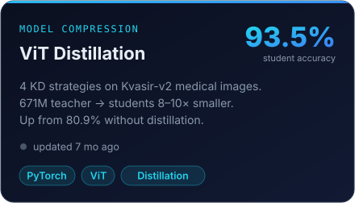</a></td>
    <td width="50%"><a href="https://github.com/Angmtlln/Vision-Transformers-for-Histopathology">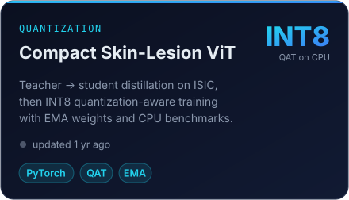</a></td>
  </tr>
  <tr>
    <td width="50%"><a href="https://github.com/Angmtlln/Efficient_NN_course">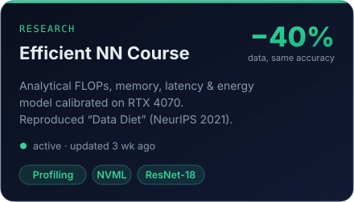</a></td>
    <td width="50%"><a href="https://github.com/Angmtlln/SMILES-2026-ZO-Limited-Resnet">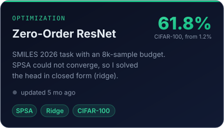</a></td>
  </tr>
  <tr>
    <td width="50%"><a href="https://github.com/Zaurall/GAI_floor_coverings">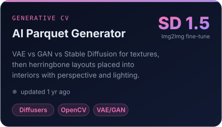</a></td>
    <td width="50%"><a href="https://github.com/SceneGenAI/scene-gen-ai">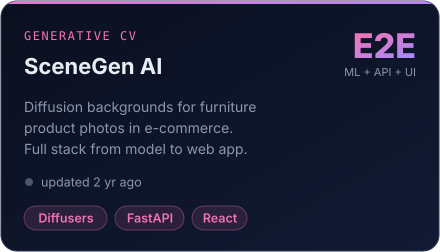</a></td>
  </tr>
  <tr>
    <td width="50%"><a href="https://github.com/Zaurall/chessmind-rl">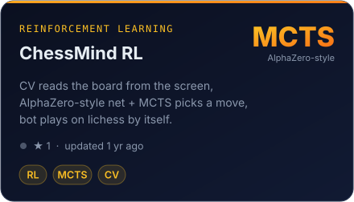</a></td>
    <td width="50%"><a href="https://github.com/Angmtlln/xaxaton">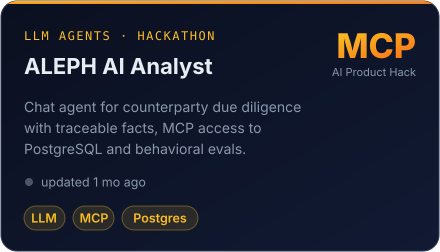</a></td>
  </tr>
</table>

<b>More projects</b>

 

| Project | What it is | Stack |
|---|---|---|
| [XAI](https://github.com/Zaurall/XAI) | Explainable hiring model, CatBoost with SHAP and a comparison of Shapley value approximations | CatBoost, SHAP |
| [EcoHack](https://github.com/Angmtlln/EcoHack) | Marine debris segmentation on Sentinel-2 multispectral imagery with a Streamlit demo | Rasterio, Streamlit |
| [World_map](https://github.com/Angmtlln/World_map) | Photo map of the world, each country is filled with your own photo clipped to its border | TypeScript, React, d3-geo |
| [Bigdata_assignment_2](https://github.com/Angmtlln/Bigdata_assignment_2) | BM25 search engine over Wikipedia articles, MapReduce indexing into Cassandra | Hadoop, Spark, Cassandra |

---

### 🛠 Tech stack

  

**ML** · PyTorch, Hugging Face (Transformers, Diffusers), scikit-learn, CatBoost, SHAP, OpenCV 
**Efficiency** · knowledge distillation, quantization-aware training, profiling with NVML, data pruning 
**Engineering** · FastAPI, PostgreSQL, Docker, Spark, React + TypeScript, Streamlit

---

### 📈 Live stats

  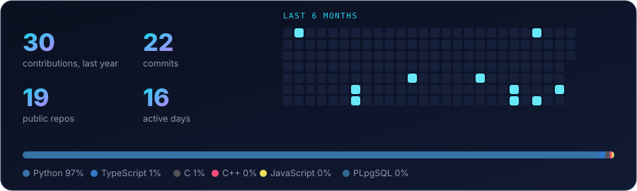

### ⚡ Recent activity

<!--ACTIVITY:START-->
- 🔨 Pushed 1 commit to [Angmtlln/Angmtlln](https://github.com/Angmtlln/Angmtlln) · 1 wk ago
- 🔨 Pushed 1 commit to [Angmtlln/Efficient_NN_course](https://github.com/Angmtlln/Efficient_NN_course) · 3 wk ago
- 🔨 Pushed 1 commit to [Angmtlln/World_map](https://github.com/Angmtlln/World_map) · 3 wk ago

Auto-updated daily by GitHub Actions · last run 31 Oct 2026
<!--ACTIVITY:END-->

  <picture>
    <source media="(prefers-color-scheme: dark)" srcset="./assets/snake-dark.svg"/>
    
  </picture>

